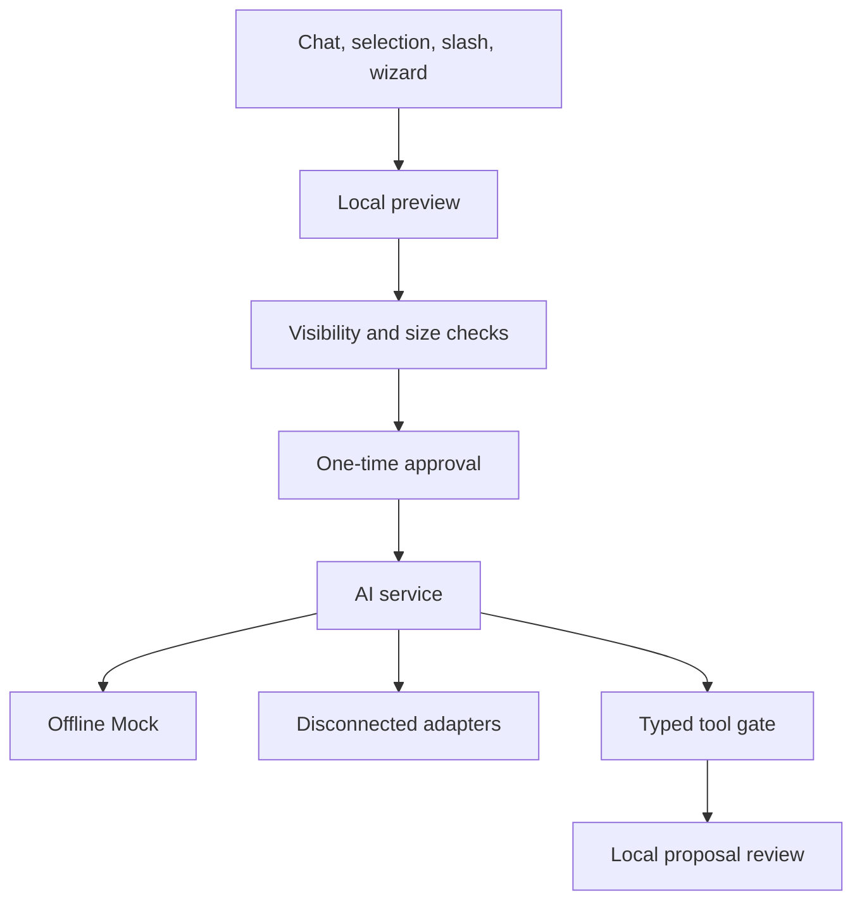
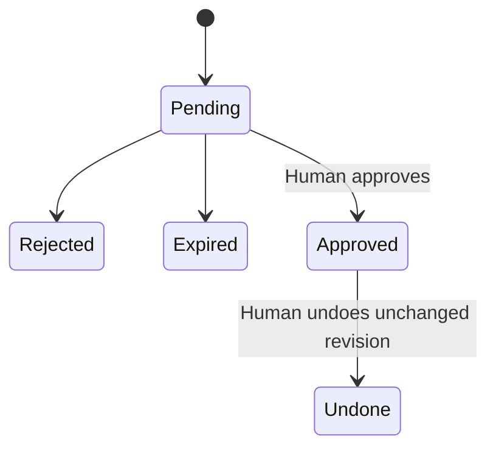
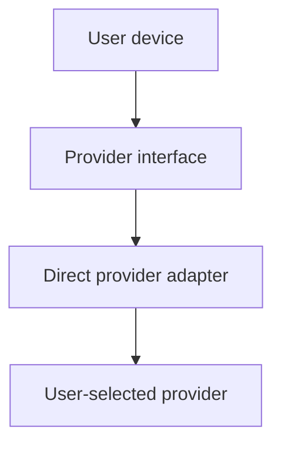

# AI architecture

## Request boundary

The editor's selection action, slash menu, wizard and chat connect to the authenticated loopback server. AI starts off. The offline provider is available with the application's developer launch flag.

The preview is a serialized provider-neutral envelope. It contains the actual message contents, scope-marked data, tool schemas and output budget. The send uses its stored ID. The ID expires, is single use and rechecks vault session, preferences, visibility and note versions. It never authorizes fresh tool output. The chat response exists only while its panel is open.

## Proposal review

The tool gate validates types, identifiers, field sets, limits and scope. Proposal records are encrypted. Creation, updates, links, tagging and undo reuse vault commands. Note content and the proposal outcome commit in the same SQLite transaction. Updates copy the previous revision into existing note history. Undo of a newly created, still-unused note moves it to Trash. Batch approval accepts only selected new-note proposals.

## Future direct connection

The shipped cloud and local adapters return disconnected. They contain no provider URLs or model names. Complete the chosen adapter with its verified contract before enabling it. Keep outbound transport inside the adapter. Hosted proxy mode requires a separate privacy decision. Tool results go to the local UI. Forwarding a result to any provider requires a new preview and explicit approval.
