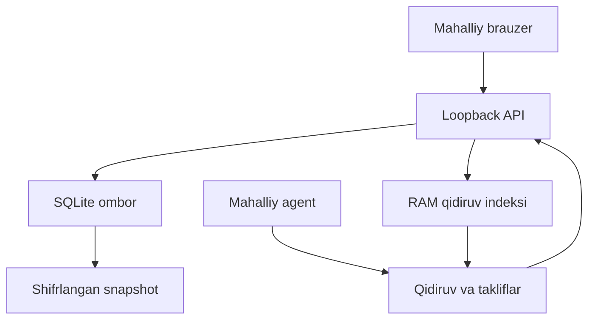

# Mahalliy arxitektura

Brauzer muharriri va agent bitta `Vault` nusxasidan foydalanadi. `Server.mutex` yozuvlar va indeksni o‘qishni tartiblaydi. Mavjud shifrlangan Markdown modeli saqlanadi. Yangi xususiyat va tarix jadvallari qayd IDsi bilan ulanadi. Mavjud `LinkIndex` Markdown va Canvas ish oqimlariga xizmat qiladi, agent va grafik tiplangan aloqalarni ham o‘qiydi.

`agent_api.search_index` qulf ochiq paytda RAMda BM25 uchun indeks tuzadi. Qidiruv sarlavha, alias, teg, matn, yo‘l va ayrim qiymatlardan foydalanadi. Natija qayd IDsi, talqin va qayd URI bilan yuboriladi. Kontekst paketi qo‘shilgan asl matn oralig‘ini beradi.

Agent API o‘qish bilan yozuv taklifini ajratadi. Taklifni Xotira interfeysi tasdiqlaganda oddiy ombor amali bajariladi. Taklif o‘n daqiqadan keyin o‘chadi. Eskirgan append so‘rovi qayd talqini o‘zgarganda rad qilinadi.

Keyingi sinxronlash tajribasi uchun mahalliy log, ikki yozuvchi va qayta ijro qoidasi ishlab chiqilishi kerak. Hozirgi snapshot ko‘chiriladigan bitta tiklash nusxasidir. Takliflar jarayon xotirasida ishlaydi.
